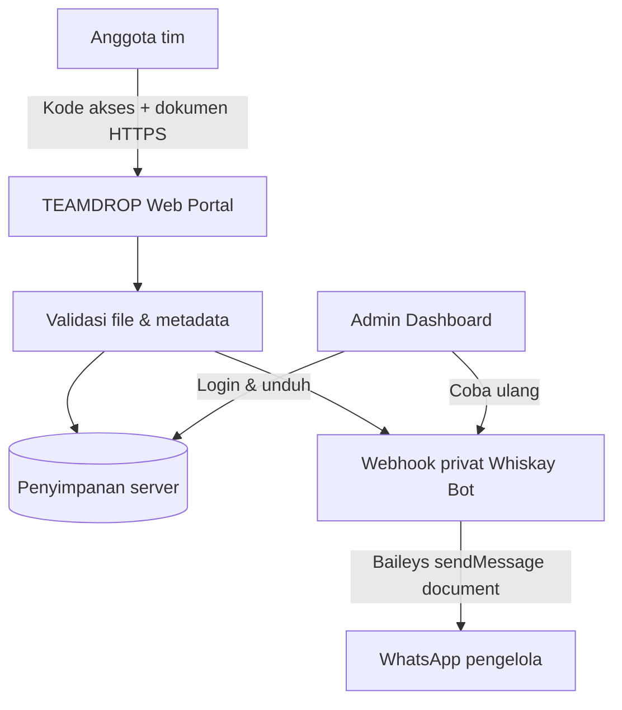

# TEAMDROP — Private Team File Portal

Portal dokumen privat agar anggota tim dapat mengirim file melalui website tanpa mengetahui atau perlu menyimpan nomor WhatsApp pribadi pengelola.

## Fitur

- Form unggah untuk anggota tim dengan kode akses bersama.
- Identitas pengirim, tim/divisi, catatan, dan file tersimpan pada server.
- Penerusan file sebagai **dokumen WhatsApp** melalui sesi Whiskay Bot (Baileys).
- Nomor WhatsApp tujuan dan token webhook hanya berada di konfigurasi server (`.env`), tidak pernah dikirim ke browser.
- Dashboard admin untuk melihat kiriman, mengunduh file, memeriksa status WhatsApp, dan mencoba ulang pengiriman.
- Pembatasan ukuran, ekstensi file yang diizinkan, rate limit, cookie admin HttpOnly, dan penghapusan otomatis berdasarkan masa retensi.

## Arsitektur



## Kebutuhan

- Node.js **20.20.0 atau lebih baru**.
- Server/VPS dengan penyimpanan disk persisten dan HTTPS untuk penggunaan publik.
- Whiskay Bot berjalan dan sudah login melalui Baileys. Jika portal dan bot ada di VPS yang sama, gunakan endpoint `127.0.0.1`.

> Catatan penting: pengiriman dilakukan oleh sesi WhatsApp yang sudah terhubung pada Whiskay Bot. Bila bot sedang offline, dokumen tetap tersimpan di TEAMDROP dan admin dapat mencoba mengirim ulang setelah bot tersambung.

## Instalasi lokal

```bash
unzip teamdrop-portal.zip
cd teamdrop-portal
npm install
cp .env.example .env
```

Edit `.env`. Minimal, ganti nilai ini dengan nilai unik milik sendiri:

```dotenv
TEAM_UPLOAD_CODE=kode-acak-panjang-khusus-anggota-tim
ADMIN_USERNAME=admin
ADMIN_PASSWORD=password-admin-yang-kuat-dan-unik
SESSION_SECRET=buat-string-acak-panjang-minimal-64-karakter
```

Jalankan portal:

```bash
npm start
```

Buka:

- Portal tim: `http://localhost:3000`
- Dashboard admin: `http://localhost:3000/admin`
- Health check: `http://localhost:3000/health`

## Hubungkan dengan Whiskay Bot

Isi bagian ini pada `.env` TEAMDROP:

```dotenv
WHISKAY_BOT_WEBHOOK_URL=http://127.0.0.1:8787/webhooks/teamdrop/document
WHISKAY_BOT_WEBHOOK_TOKEN=isi-token-rahasia-yang-sama
```

Pada `.env` Whiskay Bot, isi nilai yang sama untuk `TEAMDROP_WEBHOOK_SECRET`, lalu tentukan penerima dokumen:

```dotenv
TEAMDROP_WEBHOOK_SECRET=isi-token-rahasia-yang-sama
TEAMDROP_WHATSAPP_TO=628xxxxxxxxxx
TEAMDROP_MAX_FILE_MB=50
```

`TEAMDROP_WHATSAPP_TO` menggunakan format internasional angka saja (contoh Indonesia `62812xxxxxxx`, tanpa `+`). Jika dikosongkan, bot memakai `OWNER_PHONE`, entri pertama `OWNERS`, lalu akun WhatsApp yang sedang menjalankan bot. Nomor tujuan tidak pernah diteruskan ke browser.

**Deploy yang disarankan:** jalankan TEAMDROP dan Whiskay Bot pada VPS yang sama; gunakan `http://127.0.0.1:8787/...` agar webhook tidak perlu dibuka ke internet. Jika bot berjalan di Termux/server lain dan portal berada di VPS berbeda, Whiskay Bot sudah memiliki Quick Tunnel Cloudflare: ambil base URL terbaru dari `WHISKAY_BOT_WEBHOOK_PUBLIC_URL` di `.env` bot atau log startup, lalu tambahkan `/webhooks/teamdrop/document` pada `WHISKAY_BOT_WEBHOOK_URL` di `.env` portal. URL TryCloudflare berubah setelah tunnel dibuat ulang, jadi perbarui endpoint portal setiap kali berubah. Gunakan token webhook yang kuat; jangan membuka port `8787` langsung ke internet.

Restart Whiskay Bot dan TEAMDROP setelah mengubah `.env`. Kirim satu file percobaan, lalu periksa statusnya di dashboard admin.

## Batas file

Default batas unggah adalah 50 MB (`MAX_FILE_MB`). Ekstensi dokumen yang diizinkan: PDF, DOC/DOCX, XLS/XLSX, PPT/PPTX, TXT, CSV, dan OpenDocument. Batas ini sengaja konservatif; Whiskay Bot juga menerapkan batas `TEAMDROP_MAX_FILE_MB` (default 50 MB).

File dan metadata disimpan pada `uploads/` serta `data/submissions.json`. Default masa retensi 14 hari (`RETENTION_DAYS`), dihitung dari tanggal unggah. Direktori tersebut harus berada di disk persisten dan jangan dipublikasikan sebagai static directory.

## Deploy ke VPS

Aplikasi ini memakai disk lokal untuk file dan metadata, sehingga paling cocok dijalankan pada VPS atau platform yang menyediakan persistent disk. Jangan mengandalkan filesystem sementara serverless untuk penyimpanan dokumen.

1. Pasang Node.js 20.20+ pada VPS.
2. Upload folder project, jalankan `npm install`, isi `.env`, lalu jalankan `npm start`.
3. Jalankan di belakang reverse proxy (misalnya Nginx) dengan HTTPS. Aktifkan `NODE_ENV=production` agar cookie admin memakai flag `Secure`.
4. Batasi akses ke port aplikasi hanya dari reverse proxy; jangan expose port backend secara langsung.
5. Cadangkan `data/` dan `uploads/` secara aman. Folder ini berisi dokumen anggota tim.

### Uji lokal melalui TryCloudflare

Untuk uji coba sementara, jalankan aplikasi di satu terminal:

```bash
npm start
```

Di terminal kedua:

```bash
cloudflared tunnel --url http://localhost:3000
```

Gunakan URL HTTPS yang ditampilkan Cloudflare untuk pengujian. URL quick tunnel bersifat sementara dan dapat berubah saat tunnel dijalankan ulang. Untuk operasional tim, gunakan domain tetap dan server yang selalu aktif.

## Pemeriksaan

```bash
npm run check
npm test
```

## Keamanan operasional

- Jangan commit `.env`, `uploads/`, atau `data/submissions.json` ke GitHub.
- Gunakan kode akses tim yang berbeda dari password admin.
- Gunakan HTTPS untuk website publik.
- Batasi anggota yang menerima kode akses dan rotasi kode bila bocor.
- Simpan cadangan dokumen dan hapus data sesuai kebijakan tim.
- Untuk penggunaan produksi dengan dokumen sensitif, tambahkan pemindaian antivirus pada file sebelum meneruskan ke WhatsApp serta pertimbangkan database dan penyimpanan objek privat.

## Integrasi WhatsApp

TEAMDROP mengirim byte file ke endpoint webhook privat Whiskay Bot. Whiskay Bot meneruskannya menggunakan `sock.sendMessage()` Baileys dengan properti `document`, `mimetype`, `fileName`, dan `caption`. Tidak diperlukan WhatsApp Business Cloud API atau access token Meta.
